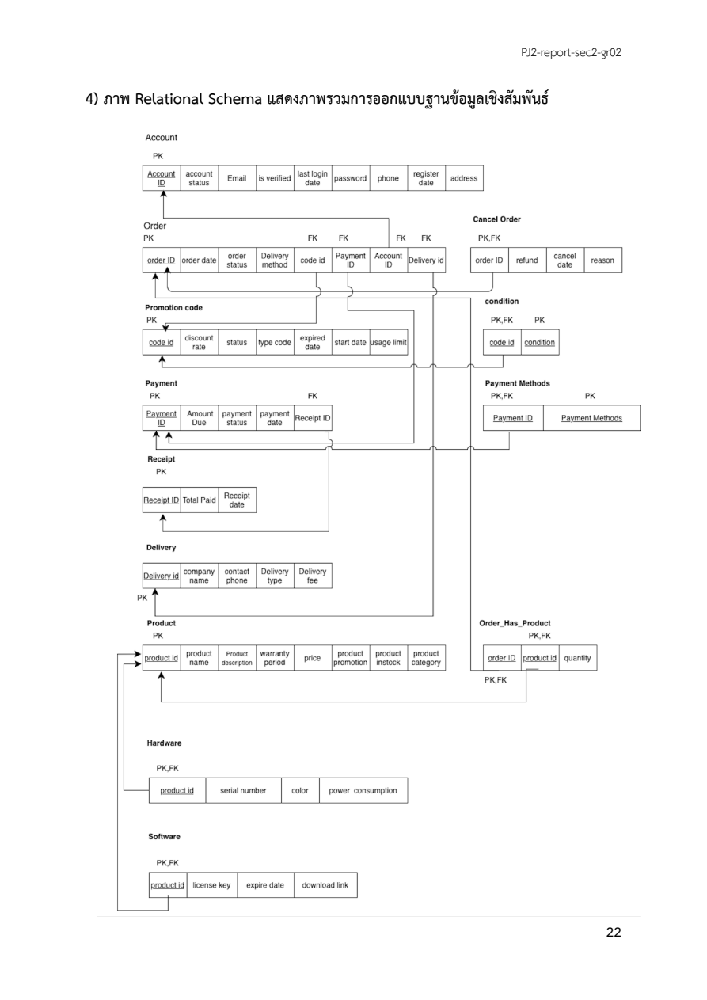

# BaNANA Online Database Design

Academic database analysis and design for an online IT retailer, created for **ITDS221 Database Management Systems, Section 02, Group 02, Mahidol University**.

This repository documents business requirements, an EER model, relational mapping, normalization to third normal form (3NF), and a data dictionary. It is an academic case study based on BaNANA Online, with no affiliation or endorsement implied.

## Project scope

The design covers customer accounts, products, orders and order items, promotion codes, payments, receipts, delivery, and order cancellation.

**Status:** database design deliverables. No application code, executable SQL schema, seed data, or automated database tests were included in the supplied final project folder.

## Explore the project

| Artifact | File |
| --- | --- |
| Design report | [PDF](docs/database-design-report.pdf) |
| Presentation | [PDF](docs/database-design-slides.pdf) |
| EER source | [Editable draw.io](diagrams/eer-diagram.drawio) |
| Relational schema | [Editable draw.io](diagrams/relational-schema.drawio) |
| 3NF normalization | [Editable draw.io](diagrams/normalization-3nf.drawio) / [PDF](docs/normalization-3nf.pdf) |
| Data dictionary | [Editable draw.io](diagrams/data-dictionary.drawio) |

Open the PDFs directly in GitHub or a PDF reader. Open `.drawio` files in diagrams.net or the draw.io desktop application. There are no installation or database setup steps for this documentation repository.

## Design approach

1. Analyze the business processes, requirements, and rules.
2. Model entities and relationships using Chen-style ER/EER notation.
3. Map the conceptual design to a relational schema in eight steps.
4. Review functional dependencies and normalize the design to 3NF.
5. Define attributes and constraints in a data dictionary.

## Preview

## Team and individual contribution

This is a five-person group project. All source designs and reports are credited to the original ITDS221 Section 02 Group 02 team:

- นาย สุรักษ์ งามบุษกรโสภณ
- นาย คฑาเทพ เทพหัสดิน ณ อยุธยา
- นาย ศุภณัฐ แก้วการะเวก
- นาย ภัทร์ธนัชนนท์ สุดถาวรเจริญ
- นาย รัฐพงศ์ คูสกุลธรรม

## Repository preparation

- Selected the final files from the `Send2` project folder; draft versions and backups were excluded.
- Kept the editable diagram sources with descriptive filenames.
- Removed the report's original cover and the slide deck's team-identification page from these PDF copies because they contain student numbers. Group credits are retained above.
- The remaining original content and printed page numbers are preserved, so PDF page positions differ from the original report and deck.
- Word, PowerPoint, and speaking-script originals are retained outside this repository.

## Limitations and future work

The design has not been validated against a running database in this repository. A future implementation could add reviewed SQL DDL, synthetic sample data, example queries, and constraint tests. No such implementation is claimed here.

## Rights and attribution

No open-source license is granted by this repository. The academic materials remain the work of their respective authors. BaNANA names, screenshots, and other third-party materials retain their original ownership. References and the original generative-AI disclosure are preserved in the report.

---

โปรเจกต์นี้เป็นผลงานกลุ่มด้านการวิเคราะห์และออกแบบฐานข้อมูลร้านค้าออนไลน์ BaNANA มี ER/EER, Relational Schema, 3NF และ Data Dictionary โดยยังไม่มี SQL หรือแอปพลิเคชันสำหรับรันระบบจริง สำเนารายงานและสไลด์ใน repo ตัดหน้าที่มีรหัสนักศึกษาออกแล้ว และเก็บเครดิตสมาชิกไว้ด้านบน
